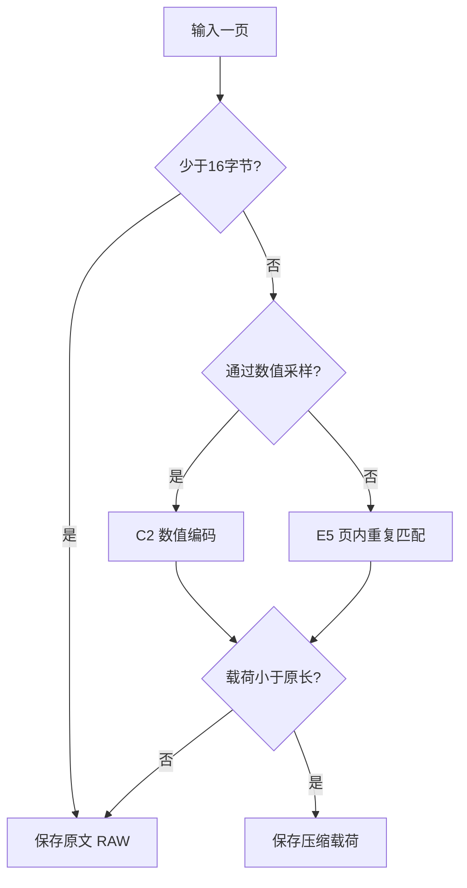

# 算法运行过程

## 1. 从一页输入到三种表示

FastPage每次处理1～4096字节，目标是快速、独立地压缩一页。没有跨页字典，也不从之前的调用继承搜索状态。



数值采样只对至少64字节的页启用。每页只完整执行C2或E5中的一条路径；C2没有缩小时直接返回RAW。少做一次完整搜索可以节省压缩时间，但采样不保证选到全页最小的表示。

## 2. 选路：16次采样

把每两个字节解释为一个小端无符号16位数；这是一种可逆解释，不要求原文真的来自数值数组。

从页内均匀选择16个位置，判断以下两条条件：

- 所有采样数都小于8192。
- 所有采样位置的相邻差都在−512～+511。

任意一条完整成立就选择C2。两条条件分别累计，不能用一个位置的“小数”和另一个位置的“小差分”拼成通过。差分使用16位回绕，例如65535到0为+1。

对于完整4096字节页，数值序号为：

```text
0, 136, 272, 409, 545, 682, 818, 955,
1091, 1228, 1364, 1501, 1637, 1774, 1910, 2047
```

最后一个采样点使用最后两个数计算相邻差，同时检查最后一个数是否小于8192。完整页在第一个采样后可提前拒绝，随后每四个采样再检查；短页按实际数目计算采样位置，每四个采样检查一次。

## 3. C2：把数值表示为较小的差

### 分组与选择

一组最多64个16位数，即128字节。每组计算两种表示所需位宽：

| 表示 | 基值 | 保存的数据 |
|---|---|---|
| FOR | 本组最小值 | 每个数减去最小值 |
| 差分 | 本组第一个数 | 相邻数的差经过ZigZag映射 |

差分位宽严格更小时选差分，否则选FOR。ZigZag把 `0,−1,+1,−2,+2` 映射成 `0,1,2,3,4`，使小的正负差都能用较少的位表示。第一个差分为0，仍保存一个字段。

位宽是表示最大字段所需的二进制位数，范围0～16。每组大小计算为：

```text
压缩子块 = 1字节标签 + 2字节基值 + ceil(count × bits / 8)
原文子块 = 1字节标签 + 2 × count
```

只有压缩子块严格更小时才使用它，否则该子块存原文。一个C2页可以混合FOR、差分和原文子块。整页载荷仍须小于原长，否则退回整页RAW。

### 手算例子

输入32个数 `60000,60001,…,60031`，共64字节。FOR需要5位，差分只需要2位，因此载荷为：

```text
C2 00 | 22 60 EA | A8 AA AA AA AA AA AA AA
页头  | 子块头   | 32个2位字段
```

`22` 表示差分模式和2位位宽，`60 EA` 是小端起点60000。解码从起点累加 `0,+1,+1,…`，精确还原64字节，保存长度13字节。

### 常量与尾字节

进入C2后先检查整页所有完整16位数是否相同。若相同，保存 `C2 80` 加2字节常量；奇数长度的最后1字节原样附后。普通C2页也将奇数尾字节原样附后。

### ARM64实现

编码使用NEON并行求最小值、最大值、差分与位宽，并按低位优先方式打包。解码每次准备四组、共32个字段：先完成独立的解包和组内前缀和，再传递组间累加值。8位字段可以直接拓宽，不必经过通用位提取。

外部输入允许精确分配。通用数值解包在子块入口验证宽读取条件；必要时把最多128字节打包数据复制到144字节的局部缓冲，并清零后面的16字节，再进行向量读取。

## 4. E5：把重复内容变成向前引用

一条记录包含：

- **字面量长度**：接下来原样复制多少输入字节。
- **距离**：从当前输出位置向前寻找多少字节。
- **匹配长度**：从那里重复还原多少字节。

例：已经输出 `ABCDEFGH`，距离8、长度16的匹配会继续输出 `ABCDEFGHABCDEFGH`。匹配可以使用本条记录刚写出的数据，因此不能用普通不重叠复制处理所有距离。

### 找到重复片段

编码器为本页准备4096项16位位置表，占8192字节。取8字节输入，计算固定种子0的CRC32C，以高12位索引哈希槽。一个槽只记最近位置，命中后再比较8字节原文，排除碰撞。

每次搜索在页尾读取余量足够时先尝试16个连续位置；后续以递增步长搜索，每个步长最多尝试28次。当前配置将后续循环按32次展开提示交给GCC。跳跃搜索减少不可压缩页的比较次数，也可能错过部分匹配。

最短搜索匹配为8字节。找到后先向前补齐相同字节，直到字面量起点或页首；再向后扩展，主要使用64位异或及首个不同字节的位置。匹配及宽读取始终受实际页长约束。

搜索表和载荷暂存区均属于本次调用。匹配总是引用同一页内已经出现的字节。

### 保存记录

页头后连续保存3字节记录；扩展长度和字面量放在后面的载荷区。这样解码器可以顺序预读下一条记录。

```text
4字节页头 | 全部3字节记录 | 扩展长度和字面量 | 尾部字面量
```

一条24位记录分配12位距离、6位字面量长度、6位“匹配长度减4”。字段达到63时继续用扩展字节表示，细节见[格式说明](format.md)。

E5主要局部数组为8 KiB位置表和4 KiB载荷暂存区；实际栈占用还包括局部变量和编译器生成的空间，应在系统集成时测量。

## 5. 解码：移动三个位置

E5解码器维护记录、载荷、输出三个游标。它没有哈希搜索，直接按记录执行复制。

| 路径 | 主要条件 | 执行 |
|---|---|---|
| 32字节快路 | 字面量≤32、实际匹配≤32、距离≥16，输入和输出余量足够 | 字面量复制32字节，匹配按顺序复制两个16字节块 |
| 64字节快路 | 字面量≤62、实际匹配≤64、距离≥64，余量足够 | 字面量和匹配各复制64字节 |
| 通用路径 | 长度扩展、短距离或接近页尾 | 解析扩展，按真实容量检查，再处理复制 |

宽复制可能多写一些即将被后续数据覆盖的字节，但快路先检查完整宽度。输出游标只按真实长度推进。末尾没有余量时走通用路径，不要求调用方补齐缓冲。

距离16～31的匹配必须按顺序完成两个16字节复制；第二块可能依赖第一块刚写出的内容。距离2～15可以构造NEON周期模板，距离1可以用字节填充。所有路径都检查距离不超过已输出历史。

## 6. RAW与无损性

当压缩载荷不小于原长，直接保存原文，不增加页头。外层用 `stored==n` 判断RAW，不能检查首字节来猜测格式。

三条还原逻辑分别是：原文直接复制；FOR加回基值或差分累加；LZ按距离引用已经还原的字节。所有数值运算按16位规则回绕，编码和解码保持一致，不存在近似或舍入。

具体接口见[api.md](api.md)，完整字段布局见[format.md](format.md)。
